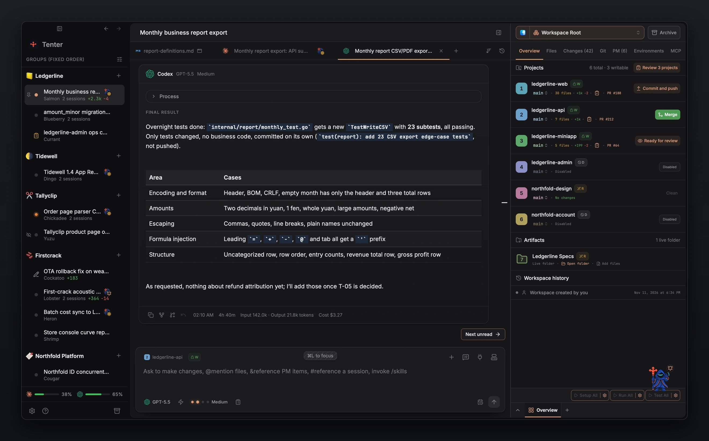
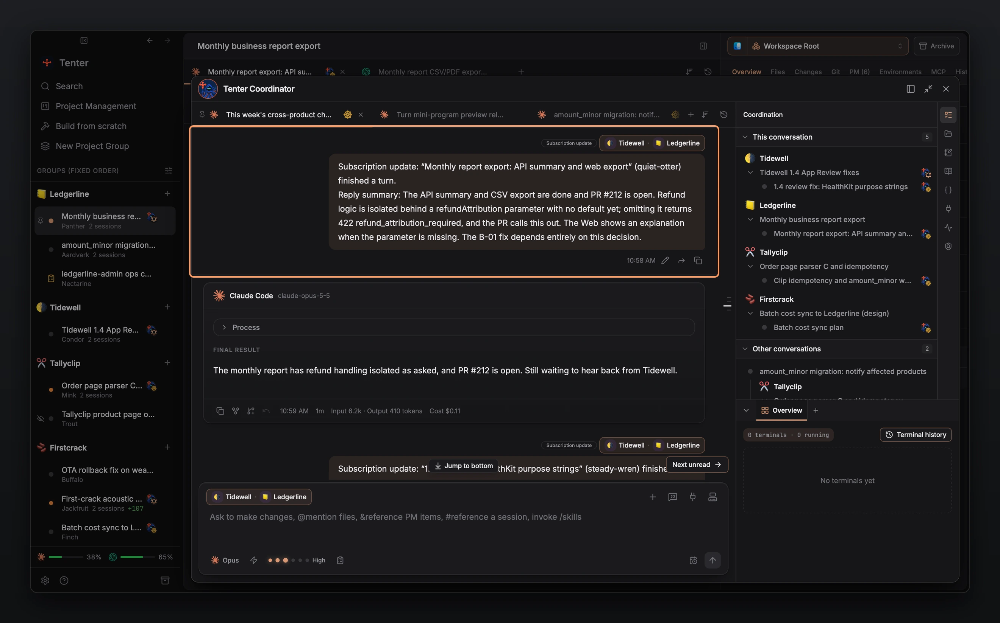
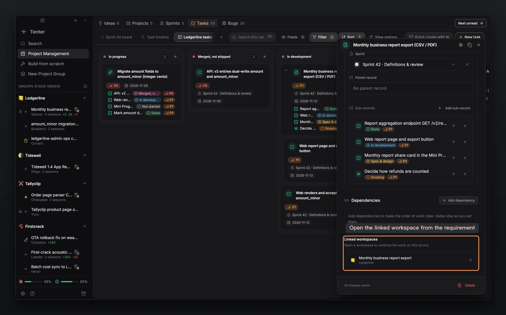
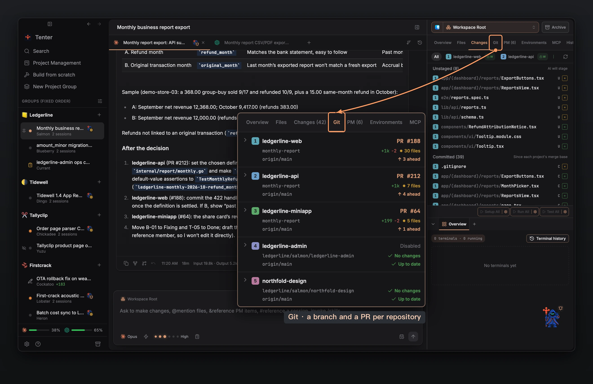

  <strong>English</strong> · <a href="README.zh-CN.md">简体中文</a>

  

<h1 align="center">Tenter</h1>

  <strong>Keep your product moving. Build. Maintain. Stay in control.</strong> 
  An AI workbench for full-stack engineers and solo builders, on one Mac.

  
  
  
  

  <a href="https://tenter.build/en/download"><strong>Download for macOS</strong></a> ·
  <a href="https://tenter.build">Website</a> ·
  <a href="https://tenter.build/en/docs">Docs</a> ·
  <a href="https://github.com/justinchen13/Tenter-Releases/releases">Release notes</a>

  

This repository hosts Tenter's official macOS releases and public bug reports and feature requests. Tenter's source code is not published here.

## What is Tenter?

Tenter is a macOS app that organizes your repositories, materials and AI work in one place, so one person can work like a whole team and ship several products at once. Bring your own Claude or Codex account; Tenter runs them side by side.

### Parallel work, isolated workspaces

Each task gets its own worktree and sessions, so Claude and Codex agents work side by side without stepping on each other. One workspace can span every repository a change touches.

### Control Center

Describe the goal once. The Control Center splits and dispatches the work, follows every conversation, and brings back only the decisions that need you.

  

### Context that compounds

Built-in project management, memory, Skills and assets are shared across workspaces. Tasks and bugs link to the workspaces doing the work, so every task starts where the last one left off.

  

### From plan to pull request

Review the plan before it runs, then review the changes, commit and open a pull request in one flow, with one branch and one PR per repository.

  

## Download

| Platform | Requirements | Download |
| --- | --- | --- |
| macOS | macOS 12 or later, Apple Silicon (M-series) | [Download the DMG](https://tenter.build/en/download) |
| Mobile | — | Coming soon |

You can also get the installer (`Tenter_<version>_aarch64.dmg`) directly from the [latest release](https://github.com/justinchen13/Tenter-Releases/releases/latest). Intel Macs are not supported.

## Getting started

1. Open the DMG and drag **Tenter** into **Applications**.
2. Launch Tenter and wait for it to prepare its managed Claude Code and Codex runtimes. You do not need to install those CLIs yourself.
3. Open **Settings → Providers**, choose Claude Code or Codex, and sign in with your subscription or add an API key.
4. [Connect your Git hosting platform](https://tenter.build/en/docs/git-setup), add a project repository, and [start your first task](https://tenter.build/en/docs/first-task).

Keep Git and your projects' own development tools installed locally. See the [installation guide](https://tenter.build/en/docs/installation) for details.

## Updates

Tenter updates itself. Open **Settings → About → Check for updates**, then restart right away or choose **Restart when idle** to let running agents finish first. Release notes for every version are on the [Releases page](https://github.com/justinchen13/Tenter-Releases/releases).

## Feedback

[Open an issue](https://github.com/justinchen13/Tenter-Releases/issues/new/choose) and choose **Bug report** or **Feature request**. You can also send feedback from inside the app.

- **Bug report**: describe what happened, the expected result, and any known reproduction steps or environment details (Tenter version, macOS version, model service).
- **Feature request**: describe your workflow, the difficulty you face, and the result you would like to achieve.

Before reporting, check the [troubleshooting guide](https://tenter.build/en/docs/troubleshooting/issues) and search [existing issues](https://github.com/justinchen13/Tenter-Releases/issues) to avoid duplicates.

> [!IMPORTANT]
> Issues and attachments are public. Review screenshots and diagnostic logs and remove sensitive information before sharing them.

Receiving a feature request does not mean that it has been scheduled for implementation.

## Community and contact

- **Discord**: join the [Tenter community](https://discord.gg/SdVeMghYvH) to exchange workflows and experiences.
- **X**: follow [@tenterbuild](https://x.com/tenterbuild) for product news.
- **Partnerships**: email [tenter.build@gmail.com](mailto:tenter.build@gmail.com).

Track bug reports and feature requests in this repository.

## Maintaining feedback

The two web forms live in `.github/ISSUE_TEMPLATE/`. Keep the `bug` and `enhancement` repository labels available so GitHub can apply each form's configured label.

Titles use `[Bug]: ` and `[Feature]: ` prefixes. Application submissions use the same prefixes so their category remains identifiable even when the submitting account cannot apply labels. Maintainers can adjust the category and labels during triage.

These templates become available on GitHub after they are merged into the repository's default branch. This repository does not automatically publish issues, upload logs, or run classification workflows.
