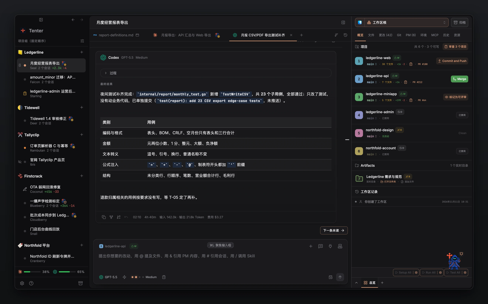
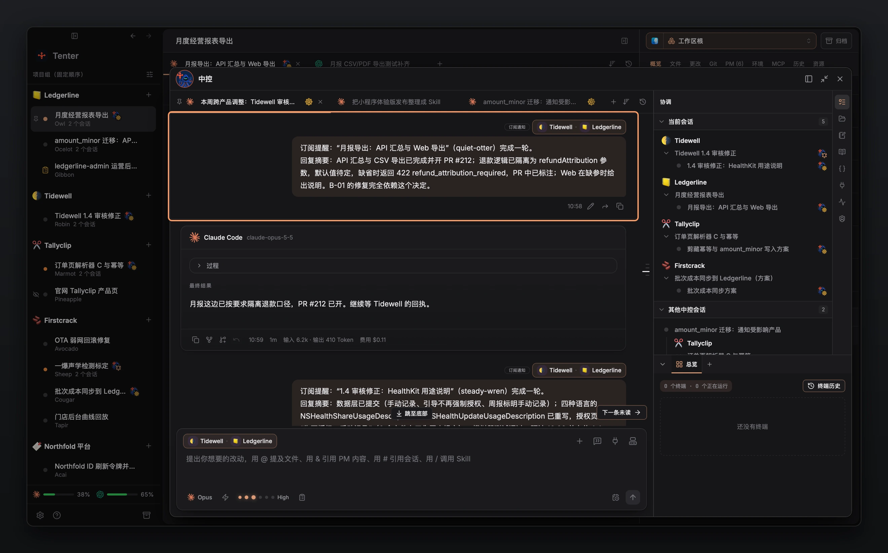

  <a href="README.md">English</a> · <strong>简体中文</strong>

  

<h1 align="center">Tenter</h1>

  <strong>让产品持续向前。开发与维护，尽在掌握。</strong> 
  跨三个仓库的需求，同时做几个也不乱。

  
  
  

  <a href="https://tenter.build/zh-CN/download"><strong>下载 macOS 版</strong></a> ·
  <a href="https://tenter.build/zh-CN">官网</a> ·
  <a href="https://tenter.build/zh-CN/docs">使用文档</a> ·
  <a href="https://github.com/justinchen13/Tenter-Releases/releases">更新日志</a>

  

## Tenter 是什么？

Tenter 把一个产品的仓库和资料组织在一起。即使多个需求涉及同一组仓库，你也可以同时推进，按需求分别审阅和交付。

### 每个需求有自己的工作区

一个工作区纳入该需求涉及的仓库和资料。各仓库有独立的 Git worktree 和分支，一个 Agent 会话可以跨仓库工作。每个仓库可设为可写、引用（只读）或禁用，由系统沙箱执行。

### 按需求审阅和交付

在一个工作区审阅该需求涉及的所有仓库改动。用 `/pr` 为每个有改动的仓库创建或更新 PR，支持 GitHub、GitLab 和 Gitea。合并使用 `/merge` 或你开启的自动化。

  

### 在中控跟进多个工作区

用[中控](https://tenter.build/zh-CN/docs/guides/control-center)在一个对话里看各工作区的进展和阻塞。启用接管后，中控可以在你授予的权限内处理常规问题和审批，把需要你拍板的事项带回来。

  

### 把项目上下文留给下一个需求

在[项目管理](https://tenter.build/zh-CN/docs/guides/project-management)里，任务和缺陷关联到实际处理它们的工作区。服务器、域名和设备各有自己的[资产记忆](https://tenter.build/zh-CN/docs/reference/assets)，Agent 下次使用时可以查阅已有的操作约定。

  

## 下载

| 平台 | 系统要求 | 下载 |
| --- | --- | --- |
| macOS | macOS 12 或更高版本，Apple Silicon（M 系列芯片） | [下载 DMG](https://tenter.build/zh-CN/download) |
| 移动端 | — | 即将推出 |

也可以从 [最新版本](https://github.com/justinchen13/Tenter-Releases/releases/latest) 直接下载安装包（`Tenter_<版本号>_aarch64.dmg`）。暂不支持 Intel 芯片的 Mac。

## 快速开始

1. 打开 DMG，把 **Tenter** 拖入「应用程序」（Applications）。
2. 启动 Tenter，等待它准备好受管的 Claude Code 和 Codex 运行时，无需自行安装这些 CLI。
3. 打开 **设置 → 服务商**（Settings → Providers），选择 Claude Code 或 Codex，用已有订阅登录，或添加 API key。
4. [连接 Git 托管平台](https://tenter.build/zh-CN/docs/git-setup)，添加项目仓库，然后 [完成第一个任务](https://tenter.build/zh-CN/docs/first-task)。

本机需要准备 Git 以及项目本身要求的开发工具。详见 [安装与连接模型](https://tenter.build/zh-CN/docs/installation)。

## 更新

Tenter 会自动更新。打开 **设置 → 关于 → 检查更新**，更新准备好后可以立即重启；如果 Agent 还在工作，选择 **空闲时重启并更新**（Restart when idle）。每个版本的更新说明见 [Releases 页面](https://github.com/justinchen13/Tenter-Releases/releases)。

## 反馈

[新建 Issue](https://github.com/justinchen13/Tenter-Releases/issues/new/choose)，选择 **Bug report**（问题反馈）或 **Feature request**（功能建议）。也可以在应用内直接提交反馈。表单为英文，可以用中文填写。

- **问题反馈**：说明发生了什么、你预期的结果，以及已知的复现步骤和环境信息（Tenter 版本、macOS 版本、模型服务）。
- **功能建议**：说明你的工作流程、遇到的困难，以及希望达到的效果。

提交前，建议先查看 [常见问题与排错](https://tenter.build/zh-CN/docs/troubleshooting/issues)，并搜索 [已有 Issue](https://github.com/justinchen13/Tenter-Releases/issues)，避免重复。

> [!IMPORTANT]
> Issue 及其附件会公开可见。分享截图和诊断日志前，请先检查并删除敏感信息。

## 社区与联系

- **Discord**：加入 [Tenter 社区](https://discord.gg/SdVeMghYvH)，交流工作流和使用经验。
- **X**：关注 [@tenterbuild](https://x.com/tenterbuild) 获取产品动态。
- **商务合作**：发送邮件至 [tenter.build@gmail.com](mailto:tenter.build@gmail.com)。

## 维护反馈模板

两个网页表单位于 `.github/ISSUE_TEMPLATE/`。请保留仓库的 `bug` 和 `enhancement` 标签，GitHub 才能为每个表单自动加上配置的标签。

标题使用 `[Bug]: ` 和 `[Feature]: ` 前缀。应用内提交也使用相同前缀，即使提交账号无权添加标签，也能识别类别。维护者可以在分类时调整类别和标签。

模板合并到仓库默认分支后才会在 GitHub 上生效。本仓库不会自动发布 Issue、上传日志或运行分类工作流。
